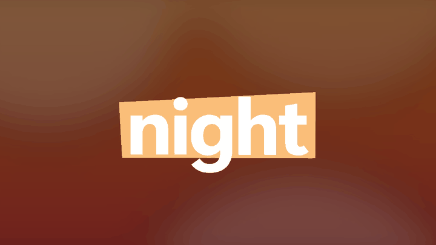
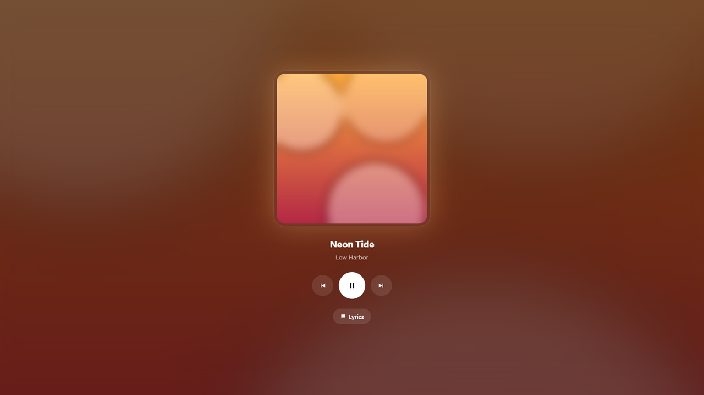
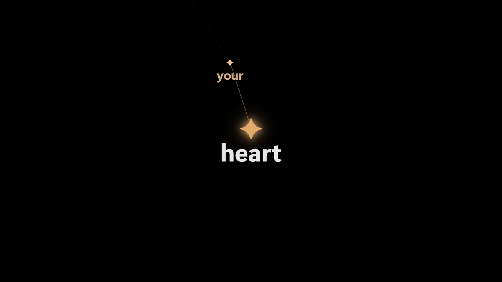
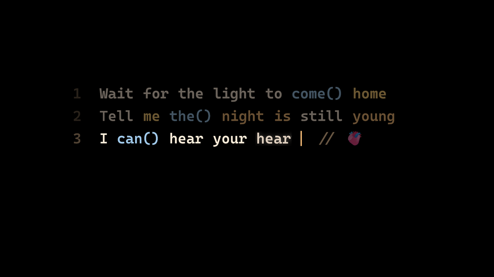

<div align="center">

# WordPulse

**Live, word-by-word lyrics for whatever you're playing, right on your Windows desktop.**

Each word lights up the moment it's sung. Works with Spotify, Apple Music, YouTube Music, Tidal and your browser. Free, open source, no account.

[](https://github.com/BhavyaKarnawat/wordpulse/releases/latest)

[](https://github.com/BhavyaKarnawat/wordpulse/actions/workflows/ci.yml)
[](LICENSE)



<sub>Shown with the built-in demo songs.</sub>

</div>

---

## What it does

- **Lyrics on your desktop.** WordPulse lives behind your desktop icons, like a live wallpaper. When music plays, the words appear; when it stops, your desktop looks normal again. No windows to manage; it sits in the tray.
- **Word by word, in time.** It uses real word timing where available and estimates the rest from each song's singing pace. If a song is off, tap along once to sync it perfectly, and it remembers.
- **16 styles.** Ship, Fisheye, Fisheye Visual, Visual, Pop, Stamp, Line, Orbit, Inkblot, Squeeze, Remold, Constellation, Branches, Web, Code and Code Visual.
- **Mood that follows the music.** It listens to the beat (on your PC only) and reads the song's speed and genre, then picks a look: Neon for rap and EDM, Bright for pop, Heavy for rock, Smooth for R&B, Soft for ballads. Words pulse on the beat.
- **Never the same twice.** Variety gives every song its own style, colour shift, tilt and motion, and Lively gives the chorus a look of its own.
- **Fullscreen views.** Lyrics, a now-playing card, or the album cover filling the screen with the lyrics on top. Real play, pause and skip controls for your music app.
- **Gets out of the way.** The lyrics fade out 10 seconds after you pause or close your music app (adjustable), and come back when you press play.
- **Light enough to leave on.** About 3% of one CPU core when music is paused. It steps aside during games and fullscreen video, and has a frame-rate setting for laptops.
- **Works offline** for songs you've played before, because lyrics are saved as you listen.

<table>
<tr>
<td><br><sub><b>Player</b>: now-playing card with controls</sub></td>
<td><br><sub><b>Album art</b>: the cover fills the screen</sub></td>
</tr>
<tr>
<td><br><sub><b>Constellation</b>: words become stars</sub></td>
<td><br><sub><b>Code Visual</b>: the line types itself out</sub></td>
</tr>
</table>

## Install

1. Download **`WordPulse-Setup-1.0.1.exe`** from [Releases](https://github.com/BhavyaKarnawat/wordpulse/releases/latest). There's also a portable `WordPulse.exe` if you'd rather not install.
2. Run it. It installs just for you (no admin rights needed) and can start with Windows.
3. Play a song. That's it.

> **"Windows protected your PC"?** WordPulse isn't code-signed yet (certificates cost money), so SmartScreen warns about new downloads. Click **More info** › **Run anyway**. The source is all here, and every release lists SHA-256 checksums.

Needs Windows 10 or 11 with the Microsoft Edge WebView2 Runtime (built into Windows 11; WordPulse links you to it if it's missing).

## Using it

Click the **tray icon** (by the clock) for Settings: style, mood, colours, fonts, position, monitor, background, frame rate and more.

| Shortcut (works anywhere) | |
|---|---|
| <kbd>Ctrl</kbd>+<kbd>Alt</kbd>+<kbd>L</kbd> | Show / hide the lyrics |
| <kbd>Ctrl</kbd>+<kbd>Alt</kbd>+<kbd>S</kbd> | Next style |
| <kbd>Ctrl</kbd>+<kbd>Alt</kbd>+<kbd>←</kbd> / <kbd>→</kbd> | Words earlier / later for this song (remembered) |
| <kbd>Ctrl</kbd>+<kbd>Alt</kbd>+<kbd>O</kbd> | Open settings |

In fullscreen or the floating window: <kbd>Space</kbd> play/pause, <kbd>←</kbd>/<kbd>→</kbd> previous/next, <kbd>L</kbd> switch view, <kbd>F11</kbd> change mode, <kbd>1</kbd>–<kbd>9</kbd> styles.

**Lyrics wrong or out of sync?** Settings › This song lets you pick another version, paste your own, or open tap-to-sync: press <kbd>Space</kbd> on every word as it's sung.

**Screensaver:** tick it in the installer, or right-click `WordPulse.scr` › Install.

## Privacy

No accounts, no ads, no telemetry. What WordPulse does:

| What | Why | What's sent |
|---|---|---|
| Reads the media session Windows shares | to know the song and its position | nothing |
| Listens to the audio that's playing | beat and tempo for the mood looks | nothing (analysed in memory, never saved) |
| [LRCLIB](https://lrclib.net) | synced lyrics | song title and artist |
| [MusicBrainz](https://musicbrainz.org) | genre tags for the mood | artist |
| Apple iTunes search | sharp album covers (can be turned off) | song title and artist |
| GitHub | update check (only if you turn it on) | nothing personal |

Everything else stays on your PC in `%APPDATA%\WordPulse` and `%USERPROFILE%\.wordpulse`.

## FAQ

**Does every song have lyrics?** Most popular songs do. When LRCLIB has none, WordPulse says so, and you can paste lyrics and tap-sync them.

**Can it show on the lock screen?** Windows doesn't let apps draw on the real lock screen. The screensaver and fullscreen modes give you the same look.

**Will it slow my PC down?** Paused, it uses about 3% of one core. While words animate it uses more (30 fps on the desktop by default); set Frame rate to Battery for less. It stops drawing during games and fullscreen video.

**Multiple monitors?** Pick a monitor, or "All displays", in Settings › Display.

## Build from source

```powershell
git clone https://github.com/BhavyaKarnawat/wordpulse.git
cd wordpulse
python -m pip install -r requirements-dev.txt
python run_wordpulse.py --demo          # try it with the demo songs
python -m pytest -q                     # run the tests
powershell -ExecutionPolicy Bypass -File build.ps1   # exe, screensaver and installer (needs Inno Setup 6)
```

See [CONTRIBUTING.md](CONTRIBUTING.md) for how it fits together and how to add a style.

## Credits

Lyrics from [LRCLIB](https://lrclib.net), genres from [MusicBrainz](https://musicbrainz.org). Built with [pywebview](https://pywebview.flowrl.com), [PyAudioWPatch](https://github.com/s0d3s/PyAudioWPatch), [pystray](https://github.com/moses-palmer/pystray), NumPy and Pillow. Lyrics belong to their writers; WordPulse bundles none and only shows what's fetched for the song you're playing.

## License

[MIT](LICENSE). Free to use, share and build on.
